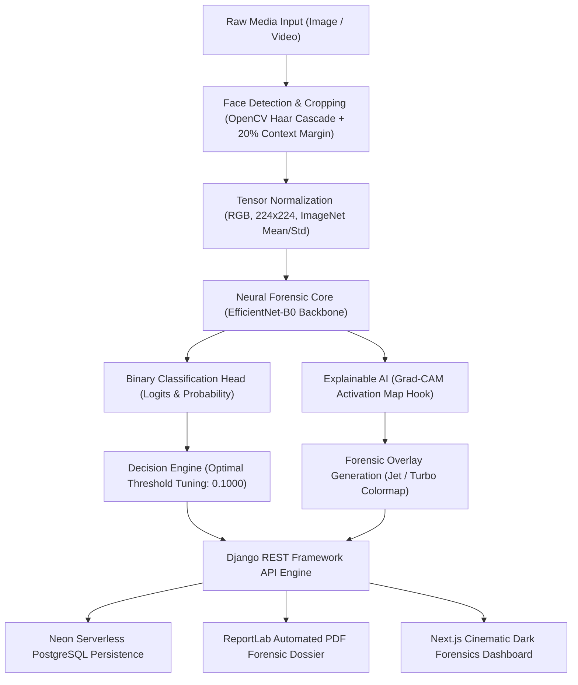

# Architecture Specification — Doomsday Sentinel

**System Name:** Doomsday Sentinel — AI-Powered Deepfake & Synthetic Media Forensics  
**Problem Statement:** Future Tech FT-02 — Deepfake & Synthetic Media Detection  
**Revision:** v1.0.0 (Production Hackathon Release)

---

## 1. Subsystem Architecture

### 1.1 Data Preprocessing & Leakage Prevention Pipeline
- **Face Isolation:** Utilizes OpenCV Haar Cascade classifier (`haarcascade_frontalface_default.xml`) with an intentional 20% context margin. In forensic facial analysis, blending seams and color boundaries commonly manifest near hairline, neck, and jawline contours.
- **Aspect Ratio Fallback:** When faces are angled or partially occluded, a square center-crop preserves aspect ratio and tensor dimensions (224x224) without image warping.
- **Strict Anti-Leakage Protocol:** All samples are strictly partitioned by `source_video_id` (40 discrete source identities). All extracted frames and manipulated variants belonging to an identity reside strictly within a single partition (70% Train, 15% Validation, 15% Test). Cross-split contamination is verified at **0.0%**.

### 1.2 Deep Learning Model Subsystem
- **Primary Architecture:** Transfer-learning using `EfficientNet-B0` with fine-tuning.
  - Frozen-backbone warmup phase.
  - End-to-end unfreezing with CosineAnnealingLR scheduling.
  - Automatic Mixed Precision (`torch.amp.autocast('cuda')`) on NVIDIA RTX A2000 12GB.
- **Secondary Baseline Comparison:** Conventional feature extraction (Color moments in RGB/HSV, Laplacian edge energy, Sobel gradients, and 2D Fourier frequency domain statistics) evaluated with Logistic Regression (98.3% test accuracy) and Random Forest (96.1% test accuracy).
- **Explainability:** Grad-CAM hooks attached to the final convolutional feature block (`features[-1]`), calculating backward gradients of class logits with respect to spatial feature maps.
- **Deployment Graph:** Exported to ONNX Opset 17 (`deepfake_detector.onnx`) with dynamic batching. Verified numerical parity against PyTorch within 1e-4 tolerance (measured absolute disparity: 0.00000000).

### 1.3 Backend REST API Subsystem
- **Engine:** Python 3.11 with Django 5.2 and Django REST Framework.
- **Persistence:** Configured for Neon Serverless PostgreSQL through `DATABASE_URL` with SSL verification, paired with local SQLite fallback for resilient zero-credential offline development.
- **Documentation:** Interactive OpenAPI 3.0 schema and Swagger UI powered by `drf-spectacular` (`/api/docs/`).
- **Endpoints:**
  - `GET /api/health/` — Real-time hardware, PyTorch, CUDA, and database status.
  - `GET /api/model/info/` — Model architecture, input specifications, and verified benchmark metrics.
  - `POST /api/analyze/image/` — Multipart upload with MIME validation, face cropping, inference, Grad-CAM generation, and DB record persistence.
  - `POST /api/analyze/video/` — Temporal frame extraction (2 FPS), frame-level predictions, top-20% suspicious tail mean pooling.
  - `GET /api/analyses/` — Paginated analysis history with filters.
  - `GET /api/analyses/{id}/` — Dossier retrieval.
  - `DELETE /api/analyses/{id}/` — Analysis deletion and artifact purge.
  - `GET /api/dashboard/stats/` — Forensic telemetry and class distribution statistics.
  - `GET /api/reports/{id}/` — Dynamic PDF inspection report generation via ReportLab.

### 1.4 Frontend Forensic Dashboard Subsystem
- **Framework:** Next.js 14 App Router with TypeScript and Tailwind CSS.
- **Visual Design:** Dark cinematic Doomsday aesthetic featuring near-black surfaces (`#020617`), restrained crimson alerts (`#dc2626`), and cyan technical accents (`#06b6d4`).
- **Telemetry Visualizations:** Recharts reactive donut charts, live system status pills, and side-by-side Grad-CAM viewers.

